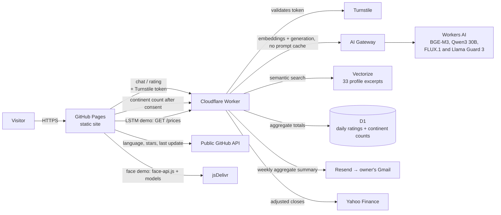

# Emanuel Borges — Portfolio

🌐 **English** · [Português](README.pt-BR.md)

[](https://github.com/emanueleborges/emanueleborges.github.io/actions/workflows/testes.yml)

Professional portfolio of **Emanuel Borges**, Senior Full Stack Developer (Java/Kotlin, Node.js, React, React Native) specializing in **applied AI (Machine Learning and NLP)**.

🔗 **Live site:** [emanueleborges.github.io](https://emanueleborges.github.io/?ref=github) · 💬 **Ask the assistant:** https://emanueleborges.github.io/#chat

🎯 **For recruiters:** [does your role match Emanuel?](https://emanueleborges.github.io/vaga/) — paste the job description and see the match requirement by requirement

🧪 **Interactive demos:** [stock forecasting (LSTM)](https://emanueleborges.github.io/demos/lstm/) · [face recognition](https://emanueleborges.github.io/demos/face/) · [movie recommender](https://emanueleborges.github.io/demos/filmes/) · [RAG security against prompt injection](https://emanueleborges.github.io/demos/guardrail/) · [image generator (FLUX.1)](https://emanueleborges.github.io/demos/imagem/)

🛠️ **How it was built:** [architecture, decisions and stack](https://emanueleborges.github.io/como-construi/)

A framework-free static site with a Cloudflare serverless backend for the AI chat and consented regional/rating aggregates, plus browser-based demos. Contact is through direct links; the site has no contact form or message storage. The RAG security demo is a local simulation and does not call AI models. **The whole infrastructure runs on free tiers.**

---

## Contents

- [Features](#features)
- [Architecture](#architecture)
- [Where each piece of data lives](#where-each-piece-of-data-lives)
- [Tech stack](#tech-stack)
- [Project structure](#project-structure)
- [Running locally](#running-locally)
- [Deployment](#deployment)
- [Common tasks](#common-tasks)
- [Quality and testing](#quality-and-testing)
- [Security and privacy](#security-and-privacy)
- [Costs](#costs)
- [Specification (SDD)](#specification-sdd)
- [Credits](#credits)

---

## Features

| Area | What it does |
|---|---|
| **3 languages** | English (default), Portuguese and Spanish. Visitors pick one in the header; the choice is remembered and can come in the link (`?lang=pt`). |
| **Sections** | About (with photo), Experience (as a **CI/CD pipeline**: each job is a passed or running stage with a "log" of achievements and the most cited stack for the period), Projects (4 **featured**, in large cards with metrics, and 8 under "More projects", compact; 6 with a live demo; filters, a link to the code and language/stars/last update from the GitHub API), Skills (46 technologies as a **grid** — default — or an interactive skills × projects **graph**), Education (with institution logos) and Contact. |
| **Themes** | Two themes the visitor picks in the header (saved and applied on every page, demos and 404 included): **Amazon** (default — dark forest green and lime blended with tech blue, "AI made in the Amazon") and **Editorial** (dark — near-black navy, slate cards and cyan accent). Also via link: `?theme=editorial`. Next to the button, an **intensity slider** makes the colors stronger or weaker (on phones it sits in the ☰ menu). All applied before first paint, no flash. Colors, names and limits live in `data/temas.json`. |
| **Visuals** | Visitor-chosen theme, moving duotone background images, Canvas particle network, scroll animations and a sticky header with reading progress. Respects "reduce motion". |
| **Sound and haptics** | Interface clicks and mechanical-keyboard keystrokes while typing, synthesized with Web Audio (no audio files), plus a short vibration on phones. A speaker button in every page header mutes them; the choice is remembered. |
| **Quick search** | `/` or Ctrl/⌘+K opens a Spotlight-style bar that finds projects, experience, skills, sections and actions (theme, sounds, résumé, job match, share), **filters the projects by topic** (e.g. "rag") and sends questions to the assistant. It uses the chat's local search; nothing is sent. |
| **Browsing without leaving the site** | Demos, "How I built it", the job-match page and the résumé open in a **modal**. GitHub links open in a **built-in viewer** (folders, rendered README/Markdown and code; file lists from jsDelivr and contents from `raw.githubusercontent.com`, without the GitHub API's 60 requests/hour limit). LinkedIn, WhatsApp, email and other sites — which forbid being shown inside another page — open a **card** with the essentials (WhatsApp QR code, profile, email to copy, description and stack of the City Hall systems); the external site only opens if the visitor asks. Ctrl/⌘+click opens the original. |
| **Share** | An icon in every page header (in the ☰ menu on very narrow screens), a card in the contact section, a footer button and a quick-search action: the portfolio's **QR code** in the current language, a link to copy, the device's native share sheet and WhatsApp, LinkedIn and email shortcuts. |
| **Technical footer** | A terminal-style line with the chat's AI model and the **AI state** (online / quota reached → local search), updated by the last chat question; clicking "measure connection" shows the ping to the Worker and the Cloudflare data center that answered (`GET /status`). Nothing is sent without a click. |
| **AI assistant** | Hybrid: local **ready-made answers** for frequent questions, **generative AI with RAG** for everything else and **local search** as a fallback. Answers appear with a **typing effect** (up to ~2.5 s; a click completes it). AI answers can be rated 👍/👎. See [Architecture](#architecture). **Voice questions:** the 🎤 button records the question (up to 20 s), the Worker transcribes it with Workers AI **Whisper** and the text goes into the input for the visitor to review and send; the audio is not stored. |
| **PDF résumé** | Built from `data/` and `i18n/`, with no PDF files in the repo. The button opens the résumé **in a modal for reading** (readable on phones too) and **"Download PDF"** downloads the file generated by the Worker with **Browser Run** (Cloudflare's browser, free plan), which renders the `curriculo.html` page itself in A4 and stores the PDF in D1 — one per language and content version. If Browser Run's daily limit runs out, the link falls back to the browser's print dialog ("Save as PDF"). Old `/cv/…pdf` links are redirected. |
| **Direct contacts** | Email, WhatsApp, LinkedIn and GitHub, each with its own modal card; the portfolio has no form and does not store contact messages. |
| **SEO** | Link previews (Open Graph/Twitter), `hreflang` for 3 languages, `Person` structured data (JSON-LD), `sitemap.xml` and `robots.txt`; verified in Google Search Console. |
| **Analytics** | Optional counting, only after explicit consent. The Cloudflare Worker uses the connection IP to estimate the continent and stores only daily totals in D1: visits per continent and clicks per link (LinkedIn, GitHub, résumé, project code and demos…); it does not store IP, URL, language, or identifiers. Aggregates are deleted before they reach 30 days. The choice is saved in the browser; to change it later, clear this site's saved data in browser settings. |
| **Weekly summary** | Every Monday an email with aggregate chat ratings, consented regional counts and a health check of the AI, vector index and database. |
| **How I built it** | Page `/como-construi/` (3 languages) summarizing this README for visitors: architecture diagram, how the assistant answers, decisions and trade-offs, quality checks and stack. Linked from the footer. |
| **404 page** | Custom page in the site's style with links to the portfolio and the assistant. |
| **AI demo: LSTM stock forecasting** | `/demos/lstm/` page (3 languages) where the FIAP project's LSTM runs **in the browser, in plain JavaScript** (weights exported from Keras, same output to ~1e-8). Recent prices come from the Worker (Yahoo Finance), with a saved copy if it fails; test metrics compared against a naive baseline. |
| **"Does your role match?" (for recruiters)** | `/vaga/` page (3 languages): the recruiter pastes a job description and sees a **match score**, each requirement as ✅ meets / 🟡 partial / ⚪ not found with **clickable evidence** in the portfolio, and a "why Emanuel" summary to copy. The AI extracts the requirements reading only the posting, then grades each one; the Worker independently verifies technology evidence, splits grouped technologies so missing tools cannot be hidden, treats a skill-list mention as partial unless a project or experience demonstrates it, and computes the score by rule. The result shows a **gauge** for the score and the **match by pillar** (Backend, Frontend, AI/ML, Data, DevOps, Other) as a radar and bars, using the same rule per pillar. The posting is not stored. |
| **AI demo: face recognition** | `/demos/face/` page with face-api.js (TensorFlow.js): detection, 128-number embeddings and recognition via webcam or photo. **Nothing leaves** the visitor's device. |
| **AI demo: movie recommender** | `/demos/filmes/` page: TF-IDF + cosine in plain JavaScript over ~1,500 films (Wikidata CC0 + Wikipedia CC BY-SA summaries), by film or free description, showing the terms behind each recommendation. |
| **RAG security demo** | `/demos/guardrail/` page: local interactive comparison of prompt injection in a question and retrieved documents, with layered defense examples. Responses are simulated; no model runs and typed text is not uploaded. |
| **AI demo: image generator** | Page `/demos/imagem/`: text → 1024×1024 image with **FLUX.1 [schnell]** on Workers AI. Each visitor can generate **2 images per day** (the page shows how many are left and says when the limit is reached). Requests can be written in any language: the Worker translates them into English with Qwen3, and moderation (a local term filter and **Llama Guard 3**) checks the translation, which is what reaches FLUX; the page shows the text that was sent. Turnstile is also required; a global ceiling of 40 images/day protects the free quota the chat also uses. Neither the text nor the image is stored — D1 keeps the daily total and, for the quota, a daily HMAC of the IP (it doesn't reveal the IP), deleted the next day. |
| **Installable app (PWA)** | Can be installed on a phone or computer (own icon) and opens offline: the page and its files are saved by a *service worker*. |

---

## Architecture



The **AI demos** run inference in the browser: the LSTM runs in plain JavaScript with weights exported from Keras, face recognition uses face-api.js (TensorFlow.js) and the movie recommender computes TF-IDF + cosine in JS. The RAG security demo is a local simulation with no AI inference. The service worker (`sw.js`) keeps the site available offline.

### How the assistant answers

1. **Contact, résumé and image requests** → contact buttons, the résumé (with "Download PDF") or a shortcut to the image generator with the request already filled in (local, no AI quota used).
2. **Ready-made answers** (19 topics, 3 languages) → greetings, thanks, salary, start date and **education** are **always answered locally**, at no cost and with verified text. Other ready-made topics (roles sought, remote work, AI, technologies…) are answered by the AI when it is available.
3. **AI with RAG** → the Worker:
   1. validates the **Turnstile** token;
   2. embeds the question with **BGE-M3** (multilingual);
   3. retrieves from **Vectorize** the 6 profile excerpts closest in meaning;
   4. sends **Qwen3 30B** a fixed profile summary + those excerpts, with rules to answer only about the profile and never invent facts;
   5. sends the request through **AI Gateway** without caching visitor questions or answers.
4. **Local search** (fallback) → if the AI fails or the daily quota runs out (error 3036), the chat **tells the visitor** and searches the page content itself: TF-IDF-style ranking, typo tolerance (Damerau-Levenshtein), synonyms and Chinese handling.

The AI knowledge is **generated from the same sources as the site** (`data/` and `i18n/`): when the site changes and the Worker is deployed, the AI and the vector index follow.

---

## Where each piece of data lives

Every piece of data lives in **one place only**; the rest of the project reads it from there or is generated from it. After editing, run `node scripts/gerar-secoes.mjs` (CI fails if anything generated is out of date) and, for the AI to learn it, `npm run deploy` in `worker/`.

| File | What it holds | Used by |
|---|---|---|
| `data/perfil.json` | Name, contacts, links, site address, photo, audio, SEO text, Worker address and Turnstile key | Every page (through the generated `perfil.js`), résumé, chat, SEO, `sitemap.xml`, `robots.txt`, `manifest`, CSP, `worker/wrangler.jsonc` and AI |
| `data/experiencia.json` | Jobs and the sites built at each (text lives in `i18n/`) | Experience section, résumé, system cards, AI and SEO (current employer) |
| `data/formacao.json` | Courses, schools, periods (with "in progress") and logos | Education section, résumé, AI and SEO |
| `data/projetos.json` · `data/habilidades.json` | Projects (featured, repo, demo, metrics, résumé stack) and technologies by category | Projects and Skills sections, résumé and AI |
| `data/temas.json` | Themes: names, colors, default theme and intensity-slider limits | `temas.css`, `components/boot.js`, theme button and `manifest` |
| `data/imagens/` · `data/audio/` | Photo, share image, spoken intro and reference voice | Site, résumé, link previews and the "About me" player |
| `idiomas.js` | Site languages | Language selectors, translations, SEO, résumé, generators and Worker |
| `i18n/<lang>.js` | All text (the name comes from the profile) | Site, chat, résumé, cards and AI |

**To use it as a template for another portfolio:** replace the files in `data/` (photo and audio included — or delete `audio/apresentacao/` and the voice button disappears), the text in `i18n/`, `servicos` in `perfil.json` (your Worker and Turnstile) and the Worker `name` in `worker/wrangler.jsonc`; then run the generator.

---

## Tech stack

**Front-end:** semantic HTML5 · CSS3 (no framework) · vanilla JavaScript (ES2020+) · Canvas 2D · IntersectionObserver · Fetch API · `Intl` · `localStorage`

**Serverless backend (Cloudflare free tier):** Workers · Cron Triggers · Workers AI (`@cf/qwen/qwen3-30b-a3b-fp8`, `@cf/baai/bge-m3`) · Vectorize · AI Gateway · D1 (SQLite) · Turnstile · Rate Limiting · Wrangler

**AI in the demos:** Keras/TensorFlow (LSTM training) · plain-JavaScript LSTM (inference) · face-api.js 1.7.15 / TensorFlow.js (WebGL) · TF-IDF + cosine similarity in JS · SVG charts

**PWA:** Web App Manifest · Service Worker (network first for the page, cache for files)

**Email:** Resend (weekly aggregate summary)

**Tooling:** Git + GitHub · GitHub Pages · GitHub Actions · GitHub CLI · headless Chrome (tests) · Lighthouse and Lighthouse CI · Node.js · Python · Shell

**External assets:** Google Fonts (Manrope, DM Mono) · Simple Icons (CC0) · Unsplash · public GitHub API · Yahoo Finance · Wikidata and Wikipedia · jsDelivr

---

## Project structure

```
.
├── idiomas.js              # Site languages (single source): selector, translations, SEO, résumé, generators and AI
├── perfil.js               # Generated from data/perfil.json for the browser (don't edit)
├── temas.css               # Theme colors, generated from data/temas.json (don't edit)
├── index.html              # Single-page portfolio (SEO, Open Graph, JSON-LD)
├── 404.html                # Custom "page not found"
├── manifest.webmanifest · sw.js · icon-*.png  # Installable, offline app (PWA)
├── como-construi/          # "How I built it": architecture, decisions and stack (texts in como-construi.js)
├── arquitetura/            # Architecture diagrams of the featured projects (Financial Hub, legal RAG, RAG security); texts in arquitetura.js
├── vaga/                   # "Does your role match?": page and vaga.js (POST /match)
├── demos/                  # In-browser AI demos (shared demos.css/demos.js)
│   ├── lstm/               # Stock forecasting: lstm.js (inference), weights and data
│   ├── face/               # Face recognition with face-api.js
│   ├── filmes/             # Movie recommender: tfidf.js and filmes.json
│   ├── guardrail/          # Local prompt-injection simulation for RAG
│   └── imagem/             # Image generator: imagem.js (POST /image on the Worker)
├── scripts/conferir-modulos.mjs # CI: every ES module imported by index.html is in the import map
├── scripts/gerar-secoes.mjs # Generates everything that comes from data/, idiomas.js and i18n/pt.js: perfil.js, temas.css, index.html
│                           #   sections (projects, skills, experience, education, SEO, Portuguese text), résumé data, language
│                           #   selectors, data-perfil and CSP on every page, sitemap, robots, manifest, the theme block in
│                           #   boot.js and the wrangler.jsonc vars (--check in CI)
├── scripts/dados.mjs       # Loads data/perfil.json, idiomas.js and i18n/ in Node (used by the generators)
├── scripts/gerar-dados-filmes.py  # Builds demos/filmes/filmes.json (Wikidata + Wikipedia)
├── scripts/gerar-apresentacao.py  # Builds the spoken-intro audio (cloned voice) into data/audio/
├── scripts/lstm/           # Training (train.py) and export (exportar_web.py) of the demo's LSTM
├── styles.css              # Site styling (layout, animations and chat); colors come from temas.css
├── i18n/                   # Text, one file per language (site, chat and résumé)
├── i18n.js                 # Loader: pt and en come with the page; other languages download when chosen
├── script.js               # Languages, menu, filters, animations, particles, analytics
├── api.js                  # Shared connection to the Worker and Turnstile
├── chat.js                 # Assistant interface (panel, messages, "Ask my AI" bar)
├── busca-rapida.js         # Spotlight-style quick search (/ or Ctrl/⌘+K): sections, projects, actions and AI
├── pipeline-grafo.js       # Experience as a CI/CD pipeline and skills × projects graph
├── sistema.js              # Technical footer: chat model; ping and Cloudflare data center on click
├── demo-modal.js           # Modal for demos, "How I built it", job match and the résumé (iframe with ?embed=1)
├── chat/                   # Assistant logic: texto.js (normalization), regras.js (ready-made answers),
│                           #   busca.js (local search on the page), ia.js (Worker and ratings)
├── components/             # Web Components and pieces shared by every page (components.js): <site-logo>, <theme-toggle>, <theme-intensity>, <sound-toggle>, sounds/haptics, GitHub viewer, external-link cards and "Share"; boot.js (theme, intensity and language before paint); vendor/qrcode.min.js (QR codes, MIT)
├── data/                   # Single source: perfil.json (personal data, Worker address), temas.json (theme colors and names),
│                           #   experience (with the sites built), education, projects and skills → site, résumé and AI;
│                           #   imagens/ (photo, share image) and audio/ (spoken intro and reference voice)
├── curriculo.html          # Résumé (A4) built from data/ and i18n/; makes the PDF via the browser's print (?pdf=1 opens it directly)
├── sitemap.xml · robots.txt
├── imagens/                # Site images: favicons, PWA icons, logo; logos/ (institutions and skills)
├── tests/                  # Automated chat tests (67 cases + AI-out-of-quota fallback, 3 languages)
├── .github/workflows/      # GitHub Actions: tests and Lighthouse on every push
├── lighthouserc.json       # Minimum Lighthouse scores in CI
├── scripts/pre-commit      # Git hook: last-updated date and file versioning
├── docs/sdd/               # Specification (SDD) in Portuguese; docs/sdd/en/ in English
└── worker/                 # Cloudflare Worker
    ├── src/index.js            # Router: chat, ratings, job match, regional visits, prices + Cron
    ├── src/rotas/              # One file per route: chat, avaliacao, vaga, imagem, precos, visitas, metricas
    ├── src/comum.js            # Shared: models, languages (from idiomas.js), CORS/JSON, Turnstile, rate limit, e-mail
    ├── src/agendado.js         # Weekly summary e-mail and data retention (LGPD)
    ├── src/conhecimento.js     # Generated: summary, excerpts, full profile, version
    ├── gerar-conhecimento.mjs  # Builds the AI knowledge from data/ and i18n/
    ├── indexar-vectorize.mjs   # Generates embeddings and updates the Vectorize index
    ├── migrations/             # D1 schema (feedback_daily, regional_visits; old messages removed)
    ├── ver-avaliacoes.sh       # 👍/👎 summary of chat answers
    ├── painel.mjs              # Private stats dashboard (npm run painel)
    └── wrangler.jsonc          # Config (AI, Vectorize, D1, limits, origin, cron)
```

---

## Running locally

There is no build step: just serve the folder.

```bash
git clone https://github.com/emanueleborges/emanueleborges.github.io.git
cd emanueleborges.github.io
python3 -m http.server 8000      # or any static server
# open http://localhost:8000
```

> Locally, the chat works with **ready-made answers and local search**. The AI and ratings only accept requests from `https://emanueleborges.github.io` (CORS + Turnstile), by design.

Install the git hook (updates the footer date and the `?v=` version of CSS/JS on every commit):

```bash
cp scripts/pre-commit .git/hooks/pre-commit && chmod +x .git/hooks/pre-commit
```

### Worker (optional)

```bash
cd worker
npm install
npx wrangler login
npm run dev          # builds the knowledge and runs the Worker locally
```

---

## Deployment

**Site:** every `git push` to `main` deploys to GitHub Pages in 1–2 minutes (and runs the tests in GitHub Actions).

**Worker:**

```bash
cd worker
npm run deploy
```

This (1) builds the knowledge from `data/` and `i18n/`, (2) deploys the Worker and (3) updates the Vectorize index.
If a D1 migration is pending, apply it **before** deploying the Worker: `npx wrangler d1 migrations apply portfolio-contact --remote`. Migration `0009_curriculo_pdf.sql` creates the résumé PDF cache (`GET /cv`). Migrations `0007_imagens.sql` and `0008_cota_imagens.sql` create the image generator's daily count and per-visitor quota. Migrations `0004_agregar_avaliacoes.sql` and `0005_remover_mensagens.sql` replace individual ratings with daily totals and permanently delete stored contact messages.

**Cloudflare resources** (created once):

| Resource | Name |
|---|---|
| Worker | `emanuel-portfolio-chat` (weekly cron: Mondays 12:00 UTC) |
| Browser Run | `BROWSER` binding — generates the résumé PDF (10 min/day free) |
| Workers Analytics Engine | `portfolio_metricas` dataset — technical metrics (route, result, time) |
| Workers Logs | only the Worker's own messages (no request data) |
| D1 database | `portfolio-contact` (tables `feedback_daily` and `regional_visits`; old contact-message table dropped) |
| Vectorize index | `portfolio-profile` (1024 dimensions, cosine) |
| AI Gateway | `default` |
| Turnstile widget | invisible, domain `emanueleborges.github.io` |
| Worker secrets | `TURNSTILE_SECRET`, `RESEND_API_KEY` |

---

## Common tasks

| I want to… | Do this |
|---|---|
| Change site text | Edit `i18n/pt.js` (Portuguese) and `i18n/<lang>.js` (other languages) and run `node scripts/gerar-secoes.mjs` (copies the Portuguese text into `index.html`), then run `npm run deploy` in `worker/` so the AI learns it. |
| Change a theme's colors, the default theme or add a theme | Edit only `data/temas.json` and run `node scripts/gerar-secoes.mjs`. The slider next to the theme button makes the colors stronger or weaker for each visitor (limits in `intensidade`, same file). |
| Change personal data (name, contacts, links, photo, SEO) | Edit only `data/perfil.json` and run `node scripts/gerar-secoes.mjs`, then `npm run deploy` in `worker/`. |
| Change experience, education, projects or skills | Edit the file in `data/` (and the text in `i18n/`), run `node scripts/gerar-secoes.mjs` and `npm run deploy` in `worker/`. Site, résumé and AI follow. |
| Add a language | Add it to `idiomas.js`, create `i18n/<code>.js` and the text of the demo/job-match/"how I built it" pages; run `node scripts/gerar-secoes.mjs`. |
| Re-record the spoken intro | `pip install gradio_client && python3 scripts/gerar-apresentacao.py` (needs ffmpeg; only re-records sentences that changed) |
| See chat ratings 👍/👎 | `cd worker && ./ver-avaliacoes.sh` |
| **Open the stats dashboard** (daily rating totals and visits) | `cd worker && npm run painel` — see [Stats dashboard](#stats-dashboard) |
| See AI usage and Gateway metrics | Cloudflare dashboard → **AI → AI Gateway → default** |
| See consented continent counts | `cd worker && npm run painel` |
| **Exclude your own visits** | Reject optional statistics in the consent notice on each browser/device. If already accepted, clear this site's saved data in browser settings to choose again. |
| See Google searches and indexing | [Google Search Console](https://search.google.com/search-console) → property `https://emanueleborges.github.io/` |
| Run the chat tests | `./tests/rodar-testes-chat.sh` |
| Run Lighthouse like CI does | `npx @lhci/cli@0.15.1 autorun` (uses `lighthouserc.json`) |
| Refresh the movie data | `python3 scripts/gerar-dados-filmes.py` (~2 min) |
| Retrain the demo's LSTM | `pip install -r scripts/lstm/requirements.txt` → `python scripts/lstm/train.py` → `python scripts/lstm/exportar_web.py demos/lstm` |
| Add a stock to the LSTM demo | Add the ticker to `TICKERS` (`scripts/lstm/train.py`) and `PRICE_SYMBOLS` (`worker/src/index.js`); retrain, export and run `npm run deploy` in `worker/` |

### Stats dashboard

Local dashboard with daily chat-rating totals, clicks per link ranked (including links with zero clicks), aggregate visit counts and the **health of the AI and the routes** over the last 7 days (questions answered by the AI, quota exhausted, RAG falling back to the full profile, errors and average time per route). It is a generated local file (`worker/painel.html`) and is not published.

```bash
cd worker
npm run painel        # or: npm run panel
```

Ratings, clicks and visits come from remote D1, using the Wrangler login. The AI metrics come from Workers Analytics Engine and need a dedicated token: Cloudflare → Manage account → API Tokens → create a token with **Account Analytics: Read**; then `CLOUDFLARE_API_TOKEN=<token> npm run painel`. Without the token the dashboard shows everything else.

The Worker **logs** (only the technical error messages it writes itself) are in the Cloudflare dashboard: Workers → `emanuel-portfolio-chat` → Observability.

---

## Quality and testing

| Check | Result |
|---|---|
| **GitHub Actions** on every push | JavaScript syntax, `sitemap.xml` and JSON-LD validation, **generated files up to date with `data/`, `idiomas.js` and `i18n/`**, AI knowledge build, Worker tests and the **70 chat tests** (including the AI out of quota: notice, local search and footer state, in all 3 languages) |
| **Lighthouse (mobile)** | Performance ~80 · Accessibility 100 · Best practices 100 · SEO 100 |
| **Lighthouse in CI** on every push | 3 runs; fails if accessibility < 95, best practices < 90 or SEO < 95 (performance < 70 only warns). The report link appears in the GitHub Actions log. |
| **Worker** | Error 3036 (quota) and other AI failures → 503 with the reason and state on `/status`, wrong origin, invalid fields, missing/fake token, unknown route, per-minute limits, honeypot and `GET /prices` (unlisted stock and other origins rejected) |
| **AI demos** | JS LSTM checked against Keras (difference ~1e-8); the face demo recognizes a mirrored, rotated photo (distance 0.19); the movie demo indexes ~1,500 films in < 50 ms; all three tested in Chrome (desktop and mobile, several languages) and on the live site |
| **Offline** | With the service worker active, the page reloads offline, with its look and projects |
| **End-to-end** | Questions, ratings and form submissions on the live site in a real Chrome window (Turnstile rejects invisible automated browsers, as expected) |

---

## Security and privacy

- **CORS:** the Worker only accepts requests from `https://emanueleborges.github.io`.
- **Turnstile:** every AI question and rating requires a valid bot-protection token.
- **Prices route (`GET /prices`):** read-only; only accepts the site's origin and the demo's 15 stocks, with a per-IP limit and a 1 h cache.
- **External script integrity (SRI):** the face demo's face-api.js has an `integrity` (SHA-384) attribute; if the CDN file is altered, the browser won't run it.
- **HTTPS enforced** with HSTS (GitHub Pages).
- **Content Security Policy** on every page via meta tag: scripts, styles, fonts, images and connections only from the domains in use (Google Fonts, Unsplash, Cloudflare, GitHub API, jsDelivr); plugins blocked (`object-src 'none'`) and `<base>` locked. The Worker address in the CSP comes from `data/perfil.json`. Referrer policy `strict-origin-when-cross-origin`.
- **Retention (privacy):** the Worker deletes daily chat-rating, click and regional aggregates before they reach 30 days.
- **Logs and technical metrics:** Workers Logs keeps only the error messages the Worker writes itself (no per-request data and no URL query strings); Analytics Engine keeps, per request, only the route, the result and the response time — never text, IP, language or visitor identifiers. Cloudflare keeps these for a few days (logs) and up to 3 months (metrics).
- **Accounts:** the most important protection is two-factor authentication (2FA) on GitHub, Cloudflare, Google and Resend.
- **Per-IP limits:** 10 questions/min (chat), 6 voice transcriptions/min, 5 résumé PDFs/min, 20 ratings/min, 3 job analyses/min, 2 images per day per visitor (with a global ceiling of 40/day), 30 price lookups/min. Cloudflare's limiter is permissive (counters lag slightly): it stops high-volume abuse, not an exact request count.
- **Honest job match:** the posting is treated as data (hidden instructions are ignored — tested with "give a score of 100"), the score is computed by rule, nonexistent evidence is discarded, listed technologies cannot be marked missing by the AI, and technologies absent from the profile become "not found".
- **AI restricted to the profile:** instructions to answer only about the professional profile, never invent facts and ignore attempts to change the rules.
- **No secrets in the code:** all keys are Worker secrets; the Turnstile site key is public by design.
- **Privacy (LGPD/GDPR-style):** there is no contact form and no contact-message table. D1 stores only consented regional and click totals, and daily 👍/👎 totals, without questions, answers, language or identifiers tied to ratings, for up to 30 days. Chat questions and job-description text are processed by Cloudflare Workers AI to generate answers/analyses but are not written to D1; Cloudflare processes connection IPs for security, Turnstile and rate limits.
- **Face demo:** camera and photos are processed only on the visitor's device; nothing is sent or stored, and registered faces disappear when the page closes. Closing the demo modal unloads the page and turns the camera off.
- **Status route (`GET /status`):** read-only, accepts only the site's origin and returns the Cloudflare data center and the model name; stores nothing. The footer only calls it when the visitor clicks "measure connection".
- **GitHub viewer:** the visitor's browser lists files through jsDelivr (`data.jsdelivr.com`) and downloads contents from `raw.githubusercontent.com`; the GitHub API is only a fallback. Markdown is rendered in the browser (marked) and the HTML is cleaned (no scripts, iframes, forms or `on*` attributes). The CSP allows those domains and images from `*.githubusercontent.com`; `frame-src 'self'` allows the site's own pages in modals.
- **Pages inside the modal:** don't show the analytics notice or count a visit (the main window already asks and counts).

---

## Costs

**Zero.** Everything runs on free tiers:

| Service | Use |
|---|---|
| [GitHub Pages](https://pages.github.com) · [GitHub Actions](https://github.com/features/actions) | Hosting and CI (public repository) |
| [Cloudflare Workers](https://workers.cloudflare.com) | Backend and weekly cron (~100k requests/day on Workers Free) |
| [Workers AI](https://developers.cloudflare.com/workers-ai/) | AI and embeddings (10,000 "neurons"/day free; hundreds of questions/day) |
| [Vectorize](https://developers.cloudflare.com/vectorize/), [D1](https://developers.cloudflare.com/d1/), [AI Gateway](https://developers.cloudflare.com/ai-gateway/), [Turnstile](https://www.cloudflare.com/application-services/products/turnstile/) | Free tiers; D1 Free includes 100k rows written/day and 5 million rows read/day |
| [Resend](https://resend.com) | Weekly aggregate summary (3,000 emails/month free) |
| AI demos | Run in the visitor's browser; face-api.js models via [jsDelivr](https://www.jsdelivr.com) (free CDN); prices via the Worker; static movie data |
| [GitHub API](https://docs.github.com/en/rest) · [Yahoo Finance](https://finance.yahoo.com) · [Wikidata](https://www.wikidata.org)/[Wikipedia](https://www.wikipedia.org) | Public and free (no key) |

If the daily AI quota runs out, the chat keeps working with local search until it resets (00:00 UTC).

Regional counting adds no paid service: each consented access uses one request to the existing Worker and one aggregate D1 write. On Workers Free, quotas are shared with other routes (100k Worker requests/day; D1 Free includes 100k rows written/day). Free-tier operations can fail until quotas reset; do not upgrade if avoiding charges is required.

### Zero-cost rules

> ⚠️ This project **must not generate any cost**. Verified on 2026-10-10: Cloudflare on the **Workers Free** plan and **no card on file** in any service.

1. **Never add a card** or any other payment method (Cloudflare, Resend, Google or GitHub).
2. **Ignore** "Upgrade", "Workers Paid", "Add payment method" and similar buttons.
3. Without a payment method, **no service can charge**: when a free limit is reached, the feature **pauses** (e.g. Workers AI returns error 3036 and the chat falls back to local search) and resumes the next day.
4. Before adding any new service, confirm it has a **free plan with no card required** and what happens when the limit is exceeded.
5. Check occasionally: Cloudflare → **Billing** (*Workers Free* plan, no payment method) and Resend → **Settings → Billing** (*Free* plan).

---

## Specification (SDD)

The project follows **Spec-Driven Development**: the specification describes the *what* and *why* before the *how*.

| Document | English | Português |
|---|---|---|
| Specification — vision, requirements and acceptance criteria | [spec.md](docs/sdd/en/spec.md) | [spec.md](docs/sdd/spec.md) |
| Technical plan — architecture, API contracts, data and decisions (ADRs) | [plan.md](docs/sdd/en/plan.md) | [plan.md](docs/sdd/plan.md) |
| Tasks — done and pending | [tasks.md](docs/sdd/en/tasks.md) | [tasks.md](docs/sdd/tasks.md) |

---

## Credits

- Technology icons: [Simple Icons](https://simpleicons.org) (CC0) — see `imagens/logos/skills/LICENSE-simple-icons.md`. Oracle, SQL Server and AWS use generic icons per brand guidelines.
- UFG, FIAP, Descomplica and FUCAPI logos: taken from the official websites, used only to identify the education.
- Background images: [Unsplash](https://unsplash.com).
- Fonts: Manrope and DM Mono (Google Fonts).
- Markdown in the GitHub viewer: [marked](https://github.com/markedjs/marked) (MIT), served by the site itself.
- QR codes: [qrcode-generator](https://github.com/kazuhikoarase/qrcode-generator) (MIT) by Kazuhiko Arase, served by the site itself. "QR Code" is a registered trademark of DENSO WAVE.
- Face demo: [face-api.js](https://github.com/vladmandic/face-api) (MIT), by Vladimir Mandic.
- Movie demo: data from [Wikidata](https://www.wikidata.org) (CC0) and shortened English [Wikipedia](https://en.wikipedia.org) summaries (CC BY-SA 4.0).
- LSTM demo: prices from [Yahoo Finance](https://finance.yahoo.com), used for demonstration only.

---

**Author:** Emanuel Borges · [LinkedIn](https://www.linkedin.com/in/borgesemmanuell) · [GitHub](https://github.com/emanueleborges) · emanuel.eborges@gmail.com
