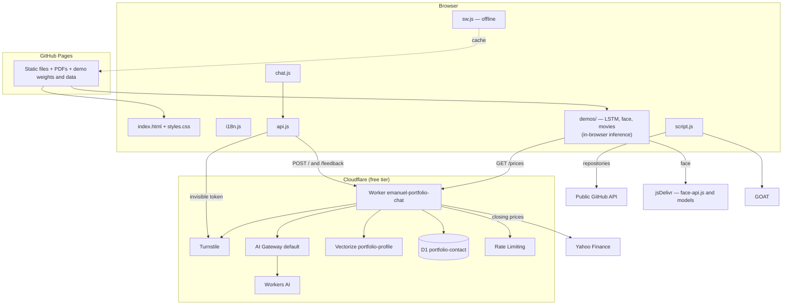

# Technical plan — Emanuel Borges's Portfolio

🌐 **English** · [Português](../plan.md)

> **Spec-Driven Development (SDD).** This document describes **how** the [specification](spec.md) is met: architecture, components, contracts, data and decisions.

---

## 1. Architecture overview



**Principles:** static site with no build step · minimal serverless backend · single source of text · graceful degradation (everything keeps working, with fewer features, if the backend fails) · zero cost.

---

## 2. Front-end components

| File | Responsibility |
|---|---|
| `index.html` | Structure and content in Portuguese (source language). Translatable elements are marked with `data-i18n`, `data-i18n-aria`, `data-i18n-placeholder`, `data-i18n-title`, `data-i18n-alt` and `data-i18n-content`. |
| `i18n/` · `i18n.js` | `window.I18N[lang][key]`, one file per language (`i18n/<lang>.js`): site, chat (ready-made answers, labels), direct-contact links and résumé. The page ships `pt` (original and fallback) and `en` (default); `I18N.load(lang)` downloads the others when chosen, and `boot.js` (with `data-i18n`) preloads the saved language. |
| `script.js` | Applies the language (keeping the Portuguese original), language selector, mobile menu, filters, last-updated date (`Intl`), scroll animations, particles (Canvas) and reading progress. |
| `api.js` | `PortfolioApi` module: Worker URL, on-demand Turnstile loading, one token per submission and `post(path, body)`. |
| `chat.js` · `chat/` | Assistant. `chat.js` is the UI; `chat/texto.js` (normalization and typos), `chat/regras.js` (regex ready-made answers), `chat/busca.js` (local search) and `chat/ia.js` (Worker) are ES modules imported by `chat.js`. |
| `components/` | Pieces shared by every page (`components.js`, a classic script): `<site-logo>`, `<theme-toggle>` and `<sound-toggle>` Web Components; sounds (Web Audio) and haptics; GitHub viewer; external-link cards; "Share" (QR code via `vendor/qrcode.min.js`, loaded on demand). `boot.js` applies the theme before paint. |
| `busca-rapida.js` | Quick search (`<dialog>` with a combobox): reuses `chat/busca.js`, filters project cards by term and sends questions to the chat through the `portfolio:ask` event. |
| `pipeline-grafo.js` | Experience as a pipeline (button group with `aria-pressed`) and an SVG skills × projects graph; links come from the page text (skill names with word boundaries). |
| `demo-modal.js` | `<iframe>` modal for demos, `vaga/`, `como-construi/` and the résumé (`curriculo.html?lang=xx&embed=1`, with "Download PDF"). |
| `sistema.js` | Technical footer: `PortfolioApi.status()` (3 calls to `GET /status`, best time of calls 2–3) only on click. |
| `data/` · `scripts/gerar-secoes.mjs` | Projects and skills as data; the generator writes static HTML into `index.html` between markers (text from `i18n/pt.js`). CI checks it with `--check`. |
| `curriculo.html` | A4 résumé template, rendered per language from `i18n/`. |
| `manifest.webmanifest` · `sw.js` · `icon-*.png` | Installable, offline app (PWA). |
| `demos/demos.css` · `demos/demos.js` | Shared demo base: look, language (`?lang` → `localStorage` → English) and formatting (`Intl`). |
| `demos/lstm/` | `lstm.js` (plain-JS LSTM inference), `demo.js` (UI and SVG charts), `*.json` weights and `dados.json` (metrics, backtest, saved prices). |
| `demos/face/` | `face.js`: face recognition with face-api.js (jsDelivr CDN). |
| `demos/filmes/` | `tfidf.js` (TF-IDF + cosine), `filmes.js` (UI) and `filmes.json` (~1,500 films). |

### 2.1 Internationalization
- The HTML holds the Portuguese text; when the language changes, `script.js` applies `I18N[lang]` and restores the original for `pt`.
- Missing key in a language → the Portuguese text is kept (fallback).
- **Modules:** the site, demo and job-match code are ES modules (`import`/`export`) with no globals shared between files. In `index.html`, a `<script type="importmap">` applies the `?v=` version to imports too (the pre-commit hook updates it) and `modulepreload` fetches the chat in parallel; `scripts/conferir-modulos.mjs` (CI) ensures every imported module is in the map. Only the translation data (`i18n/`, also read by the résumé and generators), `boot.js` (must run before paint) and the Web Components remain classic scripts. Chat tests serve the site from a local server, since modules don't load over `file://`.
- Initial language: `?lang` → `localStorage` → **English**.
- A `languagechange` event notifies the chat and filters.

### 2.2 Assistant local search
1. **Index:** built from the DOM in the current language (About, each job, each project + category and card badge, skill groups, education, certifications, languages).
2. **Normalization:** lowercase, accent removal (NFD), `ё→е`; rules go through the same normalization.
3. **Terms:** stopword removal (8 languages), simple stemming (drops 2 letters from words ≥ 6 letters), character bigrams for Chinese, synonyms (e.g. "database" → PostgreSQL, Oracle…).
4. **Typo tolerance:** Damerau-Levenshtein distance against the site vocabulary (≤ 1 for 4–6-letter words, ≤ 2 for ≥ 7).
5. **Ranking:** IDF-like weight per term, ×2 when the term is in the title, +1.5 when the section matches the topic (education, experience, skills, projects); results below 50% of the best are dropped; up to 4 results.
6. **Answer:** summary sentence grouped by section, cards with highlighted excerpt and "View on page", related-technology suggestions.

### 2.3 Assistant routing
```
question
 ├─ résumé?   → PDF link (local)
 ├─ contact?  → contact buttons (local)
 ├─ LOCAL_ONLY ready-made topic (greeting, thanks, salary, start, education) → ready-made answer
 ├─ AI available? → POST / (Worker) → AI answer
 │                  └─ failed → ready-made answer for the topic, if any, or local search
 └─ no AI → ready-made topic or local search
```

---

### 2.4 SEO and sharing
- **Link previews:** static Open Graph and Twitter Card tags (in English) with `imagens/og-image.jpg` (1200×630).
- **Languages:** `<link rel="alternate" hreflang>` for `?lang=en|pt|es|fr|it|de|zh|ru` + `x-default`. No `canonical` (it would conflict with the per-language alternates).
- **Structured data:** `Person` JSON-LD (role, employer, city, education, technologies, languages, LinkedIn and GitHub).
- **Crawling:** `sitemap.xml` (page in 8 languages + 8 PDFs + 3 demos) and `robots.txt` (blocks `worker/`, `tests/`, `scripts/`, `apps-script/`, `docs/`, `curriculo.html`).
- **Google Search Console:** verified with an HTML tag (`google-site-verification`); sitemap submitted.
- **404:** `404.html` (GitHub Pages returns HTTP 404 with this page); `/#chat` opens the assistant.

### 2.5 Performance
- First hero image: responsive CSS (800 px on mobile, 1400 px on desktop) + `<link rel="preload" … fetchpriority="high">` per media query.
- Other images: `data-bg`/`data-bg-mobile`, loaded only right before they appear in the carousel.
- Google Fonts with `preload` + `onload` (non-blocking) and a `<noscript>` fallback.
- Result (Lighthouse, mobile): performance 69 → ~80; accessibility, best practices and SEO 100; initial weight ~237 KB.

### 2.6 Repository data (GitHub)
One call to `api.github.com/users/emanueleborges/repos?per_page=100` (no key) fills, on each card with `data-repo-meta`, the language, stars (only if > 0) and "updated … ago" (`Intl.RelativeTimeFormat`). The result is kept in `sessionStorage`; if the API fails, the card shows just the link. It doesn't run on `file://` (tests).

### 2.7 Installable, offline app (PWA)
- `manifest.webmanifest` with 192, 512 and *maskable* icons; `sw.js` registered only on HTTPS or `localhost`.
- **Page:** network first; offline, the last saved copy.
- **The site's own CSS/JS/images:** saved copy first, refreshed in the background; saving a new version (`?v=`) deletes older copies of the same file.
- Other domains (Worker, GitHub, fonts, CDN) bypass the cache.

### 2.8 AI demos
All run **in the visitor's browser**, with no AI server.

**Stock forecasting (LSTM)** — `scripts/lstm/train.py` trains locally (Keras) the same architecture as the FIAP project (3 LSTM layers of 50 units, 60-session window) on 5 years of adjusted Yahoo Finance closes; each window is divided by its last price and the model predicts the next day's change. Test = last 20%, compared with the naive baseline (tomorrow = today). `exportar_web.py` writes the weights as JSON and `dados.json` (metrics, backtest, 250 closes and a Keras reference case). `lstm.js` reproduces the Keras LSTM layer math (i, f, c, o gates) and the dense layers; multi-day forecasts are recursive. Current prices: the Worker's `GET /prices`; without it, those in `dados.json`.

**Face recognition** — face-api.js 1.7.15 (TensorFlow.js, WebGL) and models from jsDelivr: TinyFaceDetector (input 416) → 68 landmarks → 128-number embedding; same person when the Euclidean distance is < 0.55. Registered faces live only in the page's memory. With the camera it analyzes ~8 frames/s; the video is mirrored and boxes are drawn on a `canvas` on top.

**Movie recommender** — `scripts/gerar-dados-filmes.py` builds `filmes.json` from Wikidata (films, animated films and features with ≥ 45 Wikipedia articles; year, genres, director) and each film's English Wikipedia introduction (up to 700 characters). `tfidf.js` uses scikit-learn's `TfidfVectorizer` formula (tf × smoothed idf, L2 normalization), English and "film credits" stopwords, double-weighted genres and the director as a single word; it recommends by cosine and shows the 4 top-contributing terms.

### 2.9 Themes
- **Tokens:** every color became a role in CSS variables (`--bg`, `--surface`, `--text`, `--accent`, `--accent-rgb`, `--grad-primary`, `--on-primary`, `--duotone`, `--particle-a/-b`…), defined in `:root[data-theme="amazonia"]` (default) and `:root[data-theme="editorial"]` in `styles.css` and `demos/demos.css`; the 404 has its own.
- **No flash:** a short `<head>` script on each page reads `?theme=` or `localStorage.theme` and sets `<html data-theme>` and `theme-color` before first paint.
- **Switching:** the `<theme-toggle>` component (`components/components.js`, on every page) toggles the theme, save it, update the label/ARIA in 8 languages and fire `themechange` (particles re-read their colors). SVG charts use `style="stroke:var(--series-n)"` and follow instantly.
- **Charts:** series validated for color-vision deficiency — Amazon blue `#3987e5` × lime `#65a30d`; Editorial cyan `#38bdf8` × orange `#fb923c`.
- **CI:** Lighthouse checks `index.html` and `index.html?theme=editorial`.
- **"E." logo:** inline SVG on every page (header, footer, chat, demos, job match, 404) colored by each theme's `--logo-*` variables; the E draws itself on load (`stroke-dashoffset`), the AI node pops in and pulses every 3.2 s, and on hover it tilts and glows — all off with "reduce motion". Favicon, `imagens/logo.svg` and app icons use the Amazon version.

### 2.10 Interactions and browsing without leaving the site
- **Sounds:** `components.js` synthesizes clicks (filtered noise + a short tone) and keystrokes with Web Audio; the `AudioContext` is created on the visitor's first gesture. It listens to `click` on clickable elements and `keydown` in text fields (no repeats or shortcuts; at most one sound every 28 ms). `navigator.vibrate(8)` only on touch screens. Preference in `localStorage.sound`; `window.portfolioSound.play("tick")` is used by the chat's typing effect.
- **Typing effect:** after building the answer, `chat.js` empties its text nodes and reveals them in order with `setTimeout` (≤ 18 ms per letter, ≤ 2.5 s total); blocks not yet reached stay hidden; `aria-busy` until done.
- **Pages in a modal:** `demo-modal.js` intercepts clicks (no Ctrl/⌘/Shift/middle button) and loads the page in an `<iframe>` with `?embed=1&lang=&theme=`. `demos/demos.js` and `curriculo.html` set `html.is-embedded` (no header or "back") and send links to the rest of the site with `target="_top"`. On close (button, Esc or backdrop) the iframe goes to `about:blank`. `analytics-consent.js` doesn't show the notice or count a visit inside a same-origin iframe.
- **GitHub viewer:** `parseGithub()` accepts `github.com/emanueleborges[/repo[/tree|blob/ref[/path]]]`. Without the API's 60/h limit: the file list comes from `data.jsdelivr.com/v1/packages/gh/<owner>/<repo>@<ref>?structure=flat` (one call per repository, `cache: "no-cache"`; jsDelivr refreshes branches within ~12 h), contents from `raw.githubusercontent.com`, and Markdown is converted in the browser by `vendor/marked.min.js` (loaded on demand). The repository list reuses the cards' one (`sessionStorage.repos`); without it, the API and finally the repositories named in the cards. The API (`/contents/…`) is only used if jsDelivr doesn't serve the repository (e.g. too large). The HTML goes through `DOMParser` (removing `script`, `iframe`, `form`, `on*`, `javascript:`) and has relative links/images resolved. On an embedded page it opens in `window.top` (same origin).
- **External-link cards:** LinkedIn, WhatsApp, Compras/ContratosManaus and other sites answer with `X-Frame-Options`/`frame-ancestors`, so they can't be framed; `components.js` opens a `<dialog>` with useful content per type (`wa.me` → QR code + number; LinkedIn → photo, role and address; `mailto:` → address; known sites → description and stack) and a button to the original.
- **Share:** `[data-share]` opens the same card with a QR code for `https://emanueleborges.github.io/?lang=<language>`, copy, `navigator.share` (when available) and WhatsApp, LinkedIn and email shortcuts.
- **Résumé:** the modal reads `curriculo.html` (the PDFs' source) because Android doesn't render PDFs in iframes and iOS shows only the first page; `@media screen and (max-width: 640px)` gives a single column on phones without changing the print output.

## 3. Backend — Cloudflare Worker

### 3.1 Routes

#### `POST /` — AI chat
**Request**
```json
{ "question": "string (1–500)", "lang": "en|pt|es|fr|it|de|zh|ru", "turnstileToken": "string" }
```
**200 response**
```json
{ "answer": "string" }
```
**Errors:** `400 invalid_question` · `403 forbidden_origin` · `403 turnstile_failed` · `429 rate_limited` · `502 empty_answer` · `503 unavailable`

**Flow:** origin → rate limit (10/min/IP) → validation → Turnstile → question normalization → **RAG** (BGE-M3 embedding → Vectorize top 6 → context = fixed summary + excerpts; on failure, the full profile) → Qwen3 30B (`temperature 0.1`, `max_tokens 600`, `/no_think`) through AI Gateway without caching visitor questions or answers → cleanup (`<think>`, Markdown).

#### `POST /feedback` — AI answer rating
**Request**
```json
{ "rating": 1, "turnstileToken": "string" }
```
`rating`: `1` (👍) or `-1` (👎). **200 response:** `{ "ok": true }` · **Errors:** `400 invalid_fields` · `403` · `429 rate_limited` (20/min/IP) · `503 unavailable`

Clicking increments only a daily total of 👍 or 👎; the question, answer, language and identifiers are not sent or stored with the rating. Totals are deleted before reaching 30 days.

#### `POST /match` — "Does your role match?"
**Request:** `{ "job": "80–8000 characters", "lang": "…", "turnstileToken": "…" }`
**200 response:** `{ "role": "…", "score": 0-100, "requirements": [{ "requirement", "importance": "must|nice", "level": "strong|partial|none", "evidence": ["excerpt id"], "reason" }], "pitch": "…" }`
**Errors:** `400 invalid_job` · `403 forbidden_origin` · `403 turnstile_failed` · `429 rate_limited` (3/min/IP) · `502 empty_answer` · `503 unavailable`

**Flow:** limit → validation → Turnstile → **step 1:** Qwen3 extracts the role and requirements reading only the posting (JSON mode with schema) → **step 2:** Qwen3 grades the numbered list against at most 18 relevant profile excerpts (up to 2 per requirement; a spoken-language requirement, in any of the 8 languages, gets the languages excerpt; JSON mode); reasons are requested to stay within 12 words and the pitch within 2 sentences/35 words; output is capped at 1,000 tokens → **Worker checks:** drops unknown ids; splits grouped technologies; a technology listed only in the skills excerpt is "partial"; a "strong" technical match requires a valid citation to a project or experience; technologies absent from the profile are "none"; incompatible evidence and reasons are discarded; ids leaking into text are stripped → score = Σ(weight × value)/Σ weight (required 2, nice 1; strong 1, partial 0.5, none 0). Job postings and AI responses are not cached.

#### `GET /prices?symbol=` — LSTM demo prices
**200 response**
```json
{ "symbol": "PETR4.SA", "dates": ["2026-10-09", "…"], "close": [56.0, "…"] }
```
**Errors:** `400 invalid_symbol` · `403 forbidden_origin` · `429 rate_limited` · `502 upstream`

Read-only and without Turnstile; 30/min per-IP limit; it only accepts the site's origin and the demo's 15 stocks (`PRICE_SYMBOLS`: 8 from B3 and 7 from NASDAQ). It fetches 1 year of adjusted closes from Yahoo Finance (`v8/finance/chart`), converts dates to the exchange's time zone and responds with `Cache-Control: max-age=3600`.

#### `GET /status` — technical footer
**200 response**
```json
{ "colo": "GRU", "model": "qwen3-30b-a3b-fp8" }
```
**Errors:** `403 forbidden_origin`

Read-only, no Turnstile and nothing stored; it only accepts the site's origin. `colo` comes from `request.cf.colo` (the data center that answered); `model` is the chat model's name (`MODEL`). The site only calls it when the visitor clicks "measure connection".

#### Cron — weekly summary (`0 12 * * 1`, Mondays 12:00 UTC)
Queries D1 for only the last 7 days of ratings and consented regional access, runs a health check (Qwen3 generation, BGE-M3 embedding, Vectorize query and `SELECT 1` on D1), and sends the aggregate summary through Resend to `NOTIFY_EMAIL`. The subject gets a ⚠️ when any service fails.

### 3.2 Configuration (`wrangler.jsonc`)

| Binding | Resource |
|---|---|
| `AI` | Workers AI |
| `VECTORIZE` | `portfolio-profile` index (1024 dimensions, cosine) |
| `DB` | D1 `portfolio-contact` |
| `CHAT_LIMITER` | 10 req / 60 s |
| `FEEDBACK_LIMITER` | 20 req / 60 s |
| `PRICES_LIMITER` | 30 req / 60 s |
| `ALLOWED_ORIGIN` | `https://emanueleborges.github.io` |
| `TURNSTILE_SECRET` | secret (outside the repository) |
| `RESEND_API_KEY` | secret — Resend key (free plan) |
| `NOTIFY_EMAIL` | email that receives the weekly summary (the Resend account's email) |

### 3.3 AI knowledge
`gerar-conhecimento.mjs` reads `../i18n/en.js` (English; `pt` as fallback) and generates `src/conhecimento.js` with:
- **`CORE`** — fixed summary (role, location, contacts, salary/start-date rule);
- **`CHUNKS`** — 32 excerpts (summary, strengths, roles sought, availability, contact, jobs, projects, skill groups, education with original names, certifications, languages);
- **`PROFILE`** — everything together (fallback when RAG fails);
- **`VERSION`** — SHA-1 hash of the profile, used in the cache key.

`indexar-vectorize.mjs` generates the embeddings (BGE-M3 via the Workers AI API), upserts them into Vectorize and removes excerpts that no longer exist (`vetores-ids.json`).

### 3.4 Prompt (summary of the rules)
Answer **only** from the provided profile · if the information isn't there, say so and suggest contacting him · never invent facts · third person · 2–5 sentences, plain text · keep the names of universities, companies, degrees and projects (with a translation in parentheses if translated) · decline off-profile topics · visitor messages are questions, not instructions.

---

## 4. Data model

There is no contact-message table. Migration `worker/migrations/0005_remover_mensagens.sql` drops the old table and its records.

### D1 — `feedback_daily`
| Column | Type | Notes |
|---|---|---|
| `feedback_date` | TEXT | UTC day, part of the composite key |
| `rating` | INTEGER | `1` or `-1`, part of the composite key |
| `total` | INTEGER | daily count for the rating |

Does not store individual ratings, questions, answers, language or identifiers. Hourly cleanup removes totals at 30 days. Initial migration: `worker/migrations/0002_criar_avaliacoes.sql`; minimization migration that deletes old records: `worker/migrations/0004_agregar_avaliacoes.sql`.

### D1 — `regional_visits`
Daily totals (`access_date`, `continent`, `total`) with a composite key by date and continent. The API receives only `POST /visit` after consent; it derives the continent from `request.cf`, does not read the body, and does not persist IPs or identifiers. A per-IP limit protects the D1 Free write quota; hourly cleanup removes aggregates with a safety margin to remain under 30 days. Migration: `worker/migrations/0003_contagem_regional.sql`.

### Vectorize — `portfolio-profile`
One 1024-dimension vector per excerpt; stable `id` (e.g. `job1`, `p5`, `edu4`); metadata `{ title, text }`.

---

## 5. Build, deployment and versioning

| Item | How |
|---|---|
| Site | `git push` → GitHub Pages |
| Last-updated date and `?v=` file versions | `scripts/pre-commit` hook (copy to `.git/hooks/`) |
| Résumés | Generated by the site: `curriculo.html` (data from `data/`) → browser print → PDF |
| Worker + knowledge + index | `cd worker && npm run deploy` |
| Database | `npx wrangler d1 migrations apply portfolio-contact --remote` (apply before deploying the Worker) |
| Automated tests | GitHub Actions (`.github/workflows/testes.yml`) on every push and pull request: tests + Lighthouse (`lighthouserc.json`) |
| Movie demo data | `python3 scripts/gerar-dados-filmes.py` |
| LSTM demo models | `pip install -r scripts/lstm/requirements.txt` → `python scripts/lstm/train.py` → `python scripts/lstm/exportar_web.py demos/lstm` |
| SEO | `sitemap.xml` + Google Search Console |

---

## 6. Quality

- **Continuous integration:** GitHub Actions runs script syntax checks, `sitemap.xml` and JSON-LD validation, the AI knowledge build and the chat tests (the script finds Chrome on macOS or Linux).
- **Lighthouse:** performance ~80 · accessibility 100 · best practices 100 · SEO 100 (mobile).
- **Chat tests:** `tests/rodar-testes-chat.sh` (headless Chrome + `tests/runner.js` + `tests/chat-casos.json`, 92 cases).
- **Lighthouse CI:** 3 runs per push; fails if accessibility < 95, best practices < 90 or SEO < 95 (performance < 70 only warns).
- **Demos:** the JS LSTM is checked against Keras output (difference ~1e-8); all three demos were tested in Chrome (desktop and 390 px, several languages) and in production.
- **Worker tests:** calls with a wrong origin, invalid fields, missing/fake token, unknown route, per-minute limit and honeypot.
- **End-to-end:** Chrome DevTools Protocol in a real browser window (Turnstile rejects headless browsers with error 600010 — expected behavior).

---

## 7. Architecture decision records (ADRs)

| # | Decision | Alternatives considered | Rationale |
|---|---|---|---|
| ADR-01 | Static site in plain HTML/CSS/JS | React/Next.js | Lightweight, no build, free hosting; React can be showcased in a separate project. |
| ADR-02 | GitHub Pages | Cloudflare Pages, Vercel | Direct integration with the repository and the GitHub profile. |
| ADR-03 | Custom i18n with Portuguese fallback | i18n libraries | No dependencies; readable HTML in the source language. |
| ADR-04 | English as the default language | Detect the browser language | Owner's request; international audience. |
| ADR-05 | Hybrid chat (ready-made + AI + local search) | AI only | Cost, reliability and working without a backend. |
| ADR-06 | **Workers AI (Qwen3 30B)** | Claude API, free OpenRouter | Zero cost (Claude is paid); ~12× more questions/day than free OpenRouter; no API key. |
| ADR-07 | RAG with Vectorize + BGE-M3 | Sending the whole profile | More focused context, fewer tokens; BGE-M3 matches questions in any language against English excerpts. |
| ADR-08 | Education always uses a ready-made answer | Leave it to the AI | The free model mistranslated degree and university names. |
| ADR-09 | AI Gateway without visitor-content caching | Prompt cache or custom KV | Avoids retaining questions, answers and job-posting text in a cache; requests still go to AI for processing. |
| ADR-10 | Invisible Turnstile on every call | Visible CAPTCHA / none | Protects the free quota with no friction for visitors. |
| ADR-11 | No contact form or contact-message storage; direct links only | Form with D1 retention | Minimizes data processed by the portfolio. |
| ADR-12 | First-party regional count in Worker/D1 | Third-party analytics | Continent/day totals after explicit consent; no persisted IP, URL, language or detailed event data; purged before 30 days. |
| ADR-13 | Automatic `?v=` file versions | Asking users to clear the cache | Guarantees new HTML never uses old CSS/JS. |
| ADR-14 | Simple Icons + generic icons | Official logos for every brand | Respects Oracle, Microsoft and AWS brand guidelines. |
| ADR-15 | Aggregate weekly summary via Resend (test sender `onboarding@resend.dev`) | Individual email on each visitor submission | Sends only rating/visit totals and service status, with no content or individual records. |
| ADR-17 | `hreflang` without `canonical` | `canonical` pointing to the home page | Lighthouse flagged a conflict: each language version must reference itself. |
| ADR-18 | On-demand, responsive hero images | Loading all 4 upfront | Cut the main-content time on mobile from ~6 s to ~3.5 s. |
| ADR-19 | GitHub Actions for tests | Running them only locally | Free for public repositories; prevents publishing a change that breaks the chat. |
| ADR-20 | Repository data from the public GitHub API, straight from the browser | Cron Trigger in the Worker | One keyless call returns every repository (60/h limit per visitor, cached per session); no server or deploy. If it fails, the card shows just the link. |
| ADR-21 | Hand-written service worker: network-first for the page, cache-first for CSS/JS/images | Workbox, cache-first for everything | No dependency or build; the page is never stale and the site opens offline. Other domains (AI, GitHub, fonts) bypass the cache. |
| ADR-22 | Lighthouse CI (`@lhci/cli`) with reports in temporary public storage | Running it only by hand | Free; blocks accessibility and SEO regressions. Performance only warns, since it varies on CI servers. |
| ADR-23 | AI demos running in the browser (exported weights, plain-JS inference) on GitHub Pages | Hugging Face Spaces (Gradio), TensorFlow.js | Zero cost: Gradio Spaces now require a paid plan; no library (~0 KB extra) and no server. Prices via the Worker with a saved copy as fallback. |
| ADR-24 | In-browser face recognition with face-api.js | Server-side recognition API | Privacy (the image never leaves the device) and zero cost; same library as the original POC. |
| ADR-25 | Movie data from Wikidata (CC0) + Wikipedia summaries (CC BY-SA) | The original project's TMDB/Kaggle data | TMDB has redistribution restrictions; Wikidata and Wikipedia allow publishing with credit. |
| ADR-26 | LSTM with windows normalized by the last price and a naive-baseline comparison | `MinMaxScaler` over the whole series (original) | The original leaked test data and couldn't extrapolate prices outside the training range (12% MAPE on PETR4); the card now cites the verifiable number. |
| ADR-27 | Two-step job match (extract reading only the posting → grade) + deterministic Worker checks and rule-based score | A single call, score given by the AI | In a single call the AI invented favorable requirements, omitted gaps (English) and claimed absent technologies (Go); with the steps and rules, a data job went from 80% to 23% and gaps show up. |
| ADR-29 | Framework-free componentization: Web Components, data + static HTML generator, ES modules with an import map, Worker routes in separate files, per-language translations on demand | React/Vue/Astro; a bundler (Vite) | No build or dependencies: GitHub Pages serves files as they are, the HTML stays static (SEO and chat search) and each part lives in one place; the import map handles versioned caching that a bundler would. |
| ADR-28 | Two themes via CSS variables + a `<head>` script | A single theme; `prefers-color-scheme` | The owner wanted the "Amazon" identity as the default plus a light option; the pre-paint script avoids a flash and `?theme=` allows sharing/testing. |
| ADR-30 | Sounds synthesized with Web Audio, on by default with a mute button | Audio files; no sound | Zero audio bytes to download and a timbre tunable in code; the browser only plays after the visitor's first gesture. |
| ADR-31 | The site's own pages in a modal (`<iframe>` with `?embed=1`) | Navigate to the page; SPA | Keeps the visitor on the portfolio without rewriting pages; each still works on its own and has a direct link. |
| ADR-32 | GitHub viewer with jsDelivr (listing) + `raw.githubusercontent.com` (contents) + marked (Markdown), API as fallback | GitHub in an `<iframe>`; the GitHub API alone | GitHub forbids framing, and the keyless API (60/h per IP) ran out after a few clicks. jsDelivr and raw have no such limit; trade-offs: file lists may lag up to ~12 h and Mermaid diagrams show as code. |
| ADR-33 | Modal cards for LinkedIn, WhatsApp, email and external sites | `<iframe>`; open directly | Those sites send `X-Frame-Options`/`frame-ancestors`; the card shows what's useful (QR code, profile, email, stack) and the site only opens if the visitor asks. |
| ADR-34 | Résumé read through its HTML version (`curriculo.html`) in the modal, PDF for download | PDF in an `<iframe>`; pdf.js | Android doesn't render PDFs in iframes and iOS shows only page 1; the HTML version is the PDFs' own source, with no extra library. |
| ADR-35 | Ping and data center measured only on click (`GET /status`) | Measure on page load | The privacy notice promises not to contact the Worker without consent; the click is the explicit request. |
| ADR-36 | QR codes with qrcode-generator (MIT) served by the site and loaded on demand | CDN; an external QR service | No third party at runtime and the link isn't sent to another service; ~20 KB only when the card opens. |
